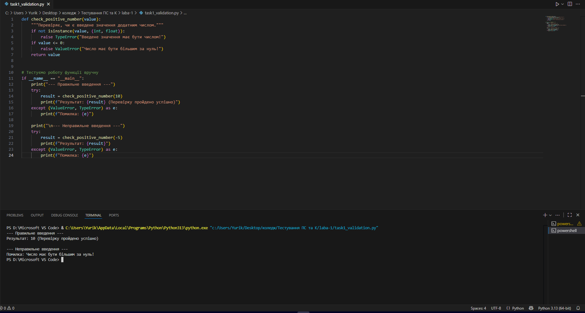
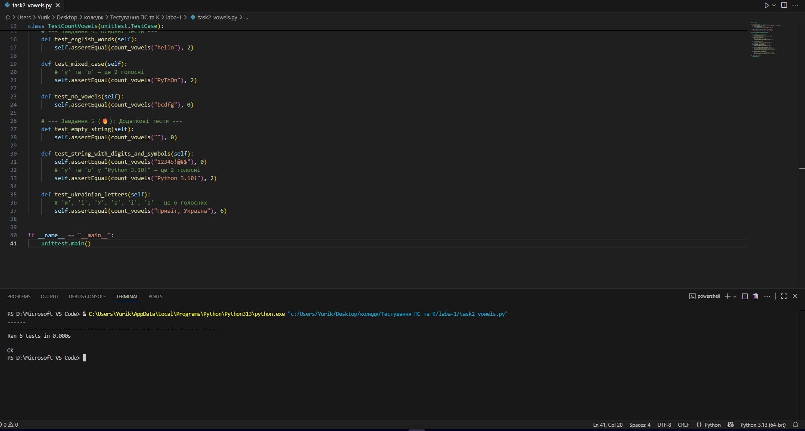
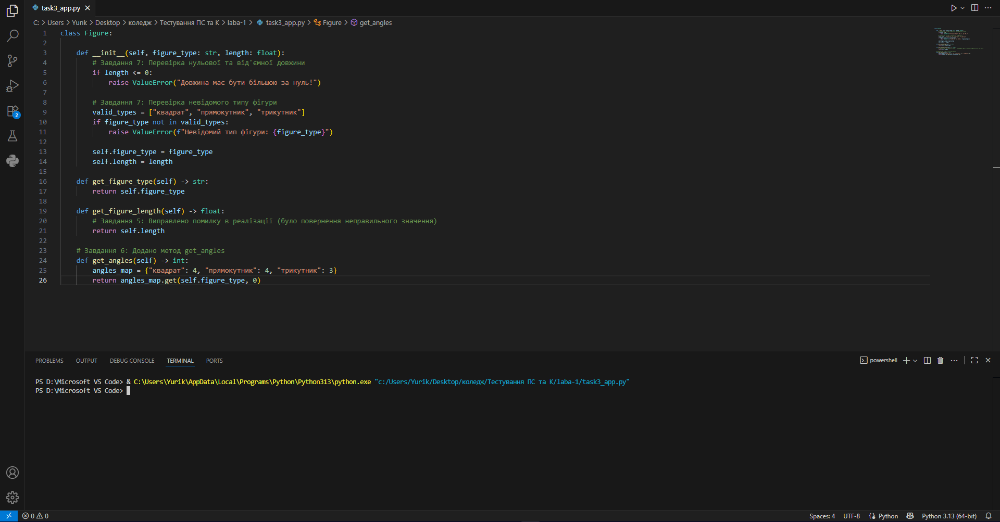
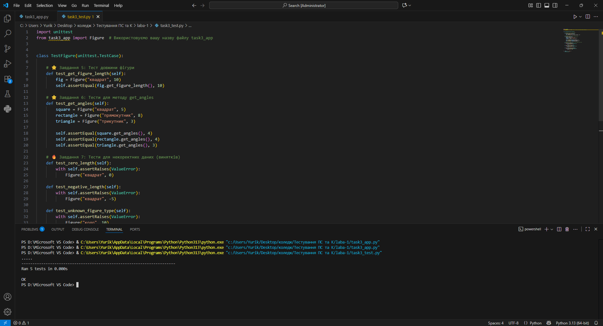
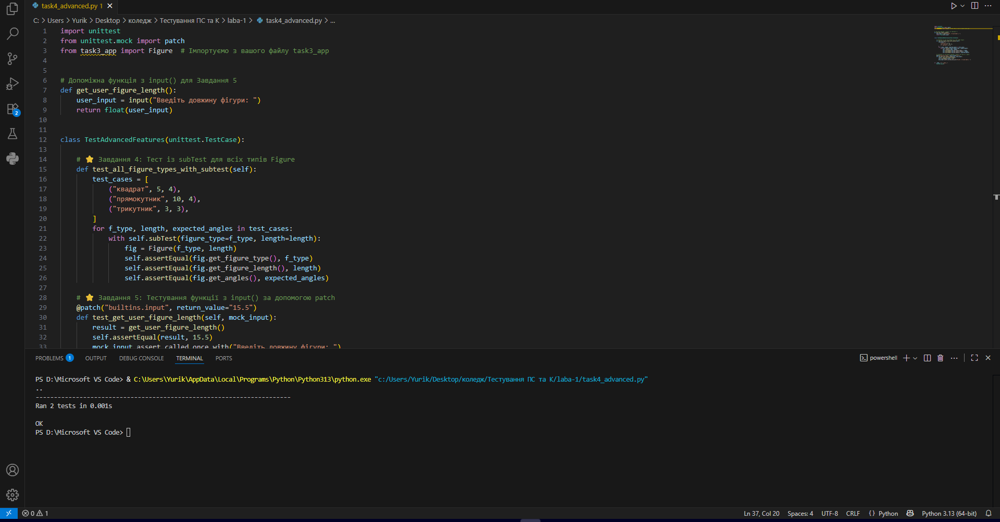

**Звіт до Роботи**

**Тема роботи: Загальне тестування та Unit тестування**

**1.Загальне тестування та юніт-тести**

**1.1.Перевірка даних — Завдання 3**

**1.2.Тестування функцій — Завдання 4**

**1.3.Тестування функцій — Завдання 5**

**2.Перший приклад**

**1.1.Перший приклад — Завдання 5**

**1.2.Перший приклад — Завдання 6**

**1.3.Перший приклад — Завдання 7**

**3.Розширені можливості**

**1.1.Розширені можливості — Завдання 4**

**1.2.Розширені можливості — Завдання 5**

