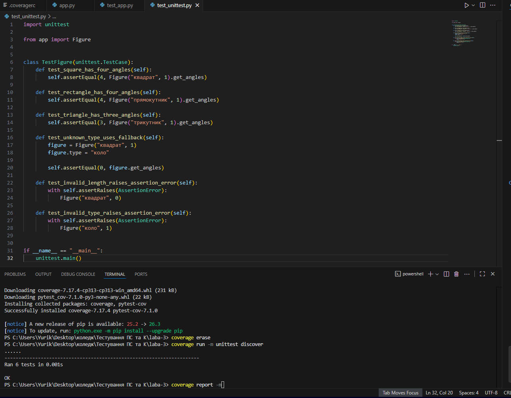
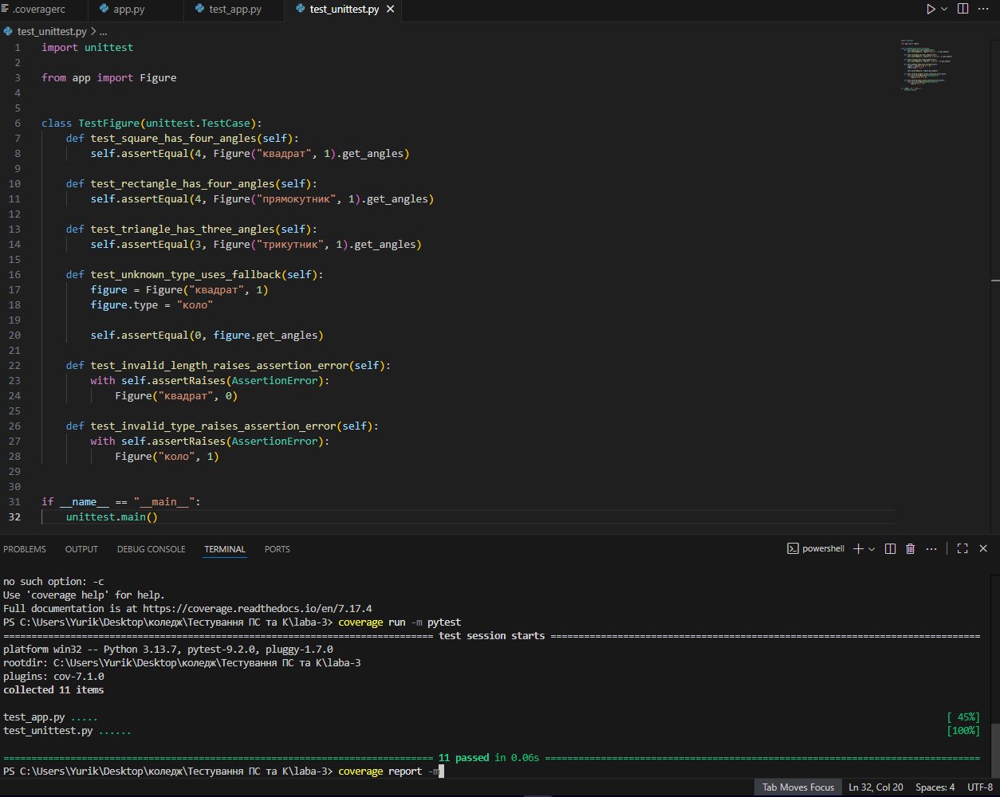
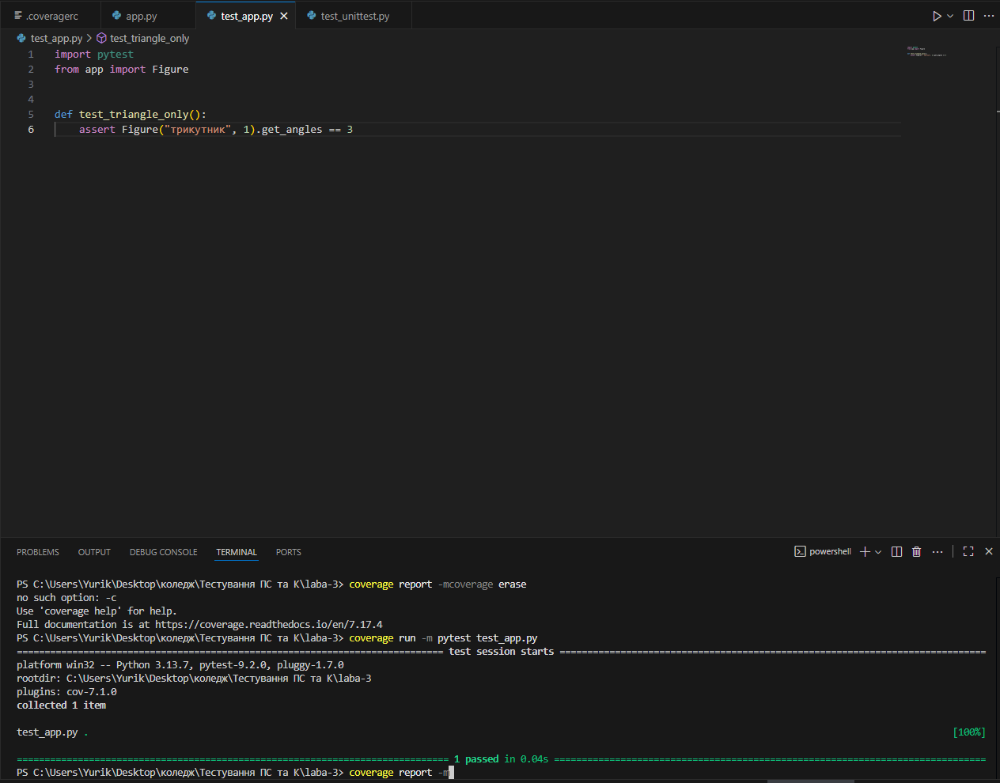
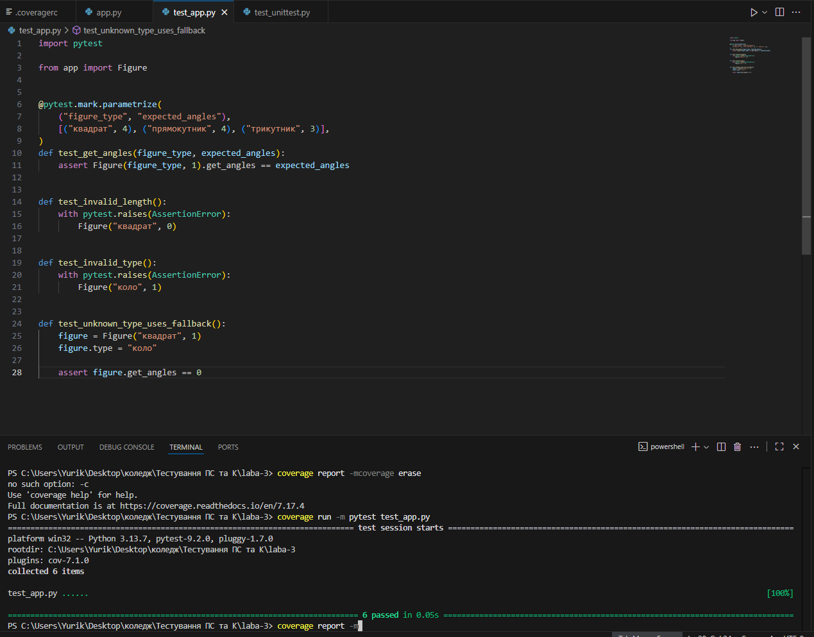
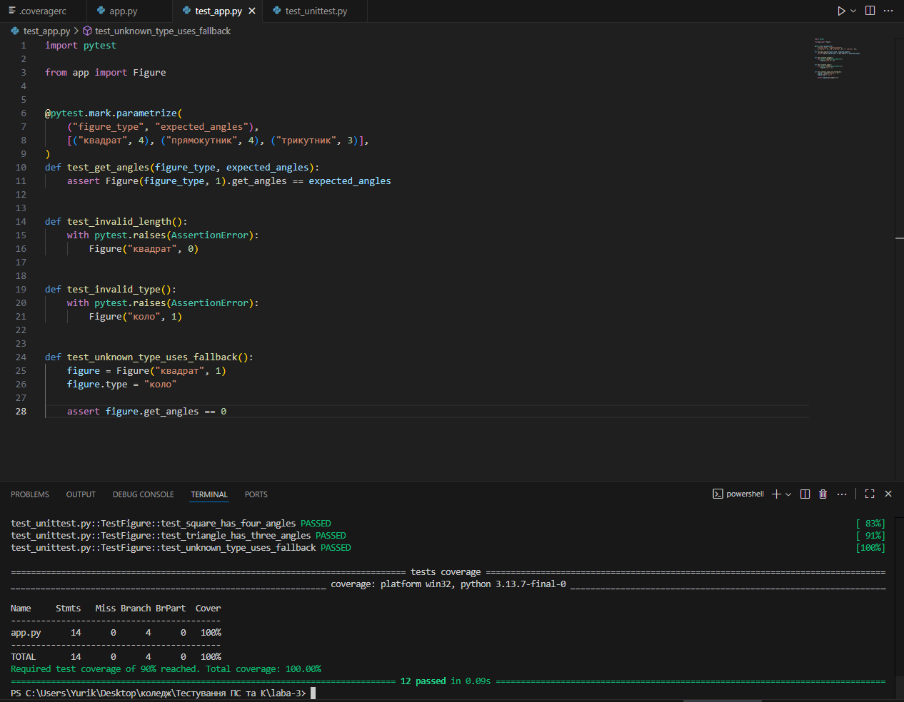
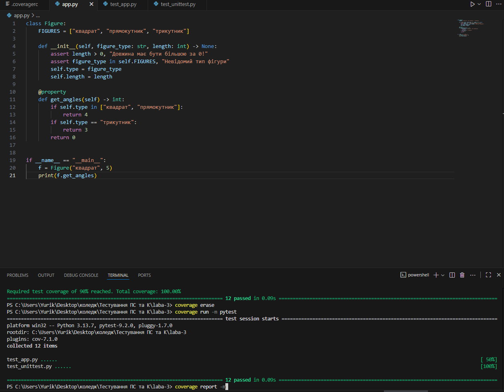
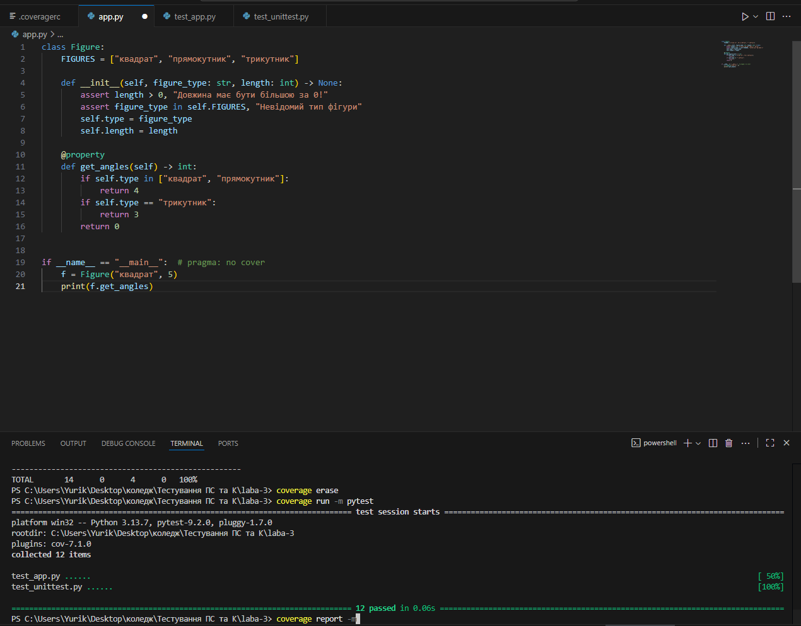
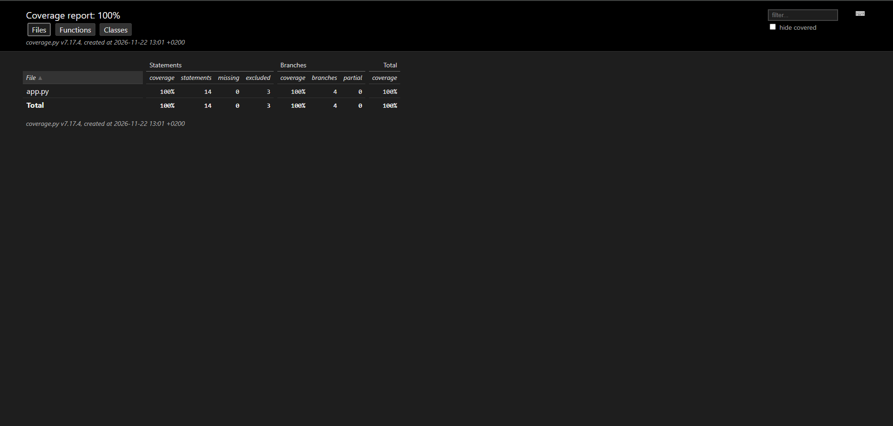
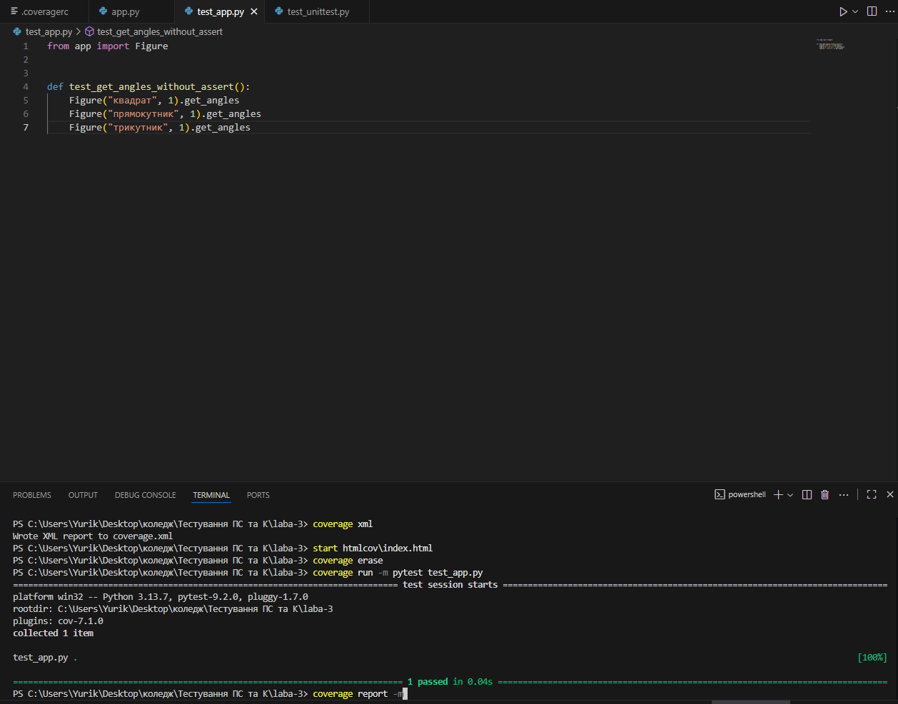
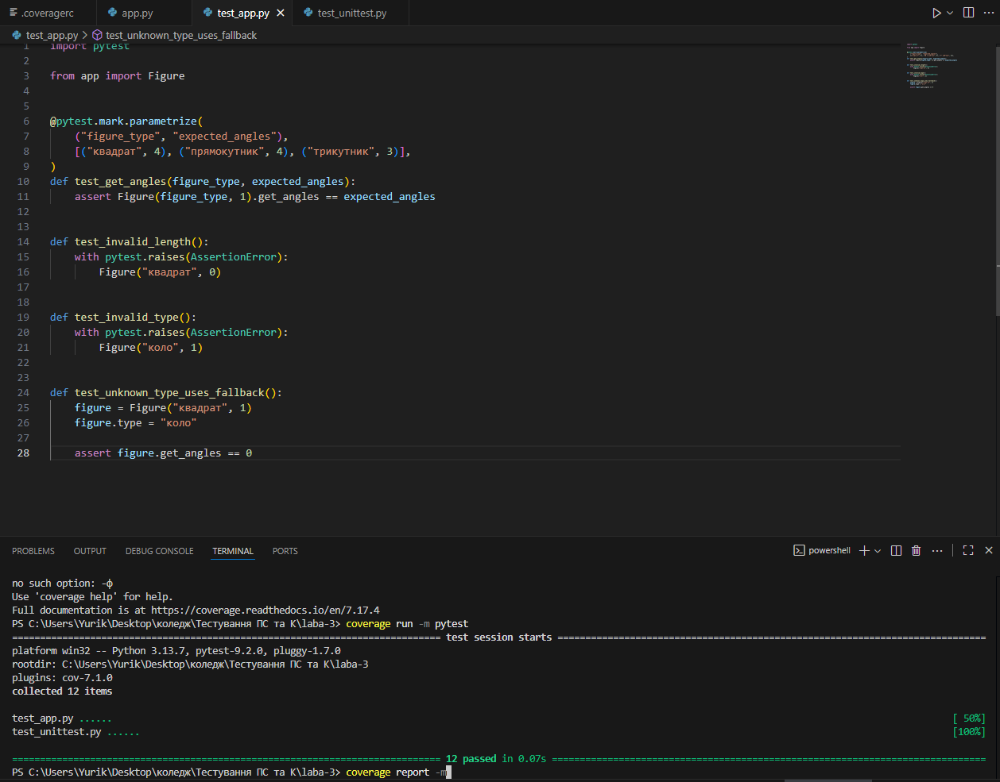

**Звіт до Роботи**

**Тема роботи: Аналіз покриття коду (Code Coverage) тестами на мові Python із використанням інструментів**

**Код та його результат у консолі, який використовувався для реалізації задач**

